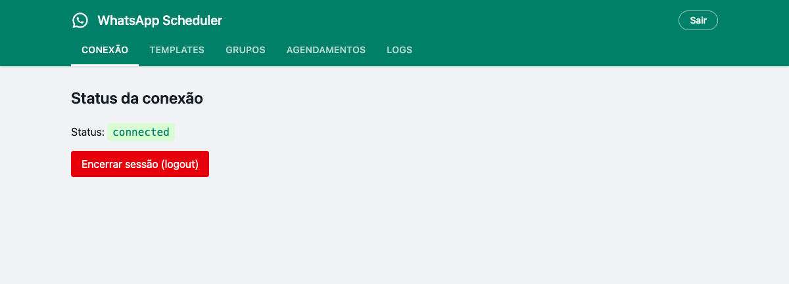
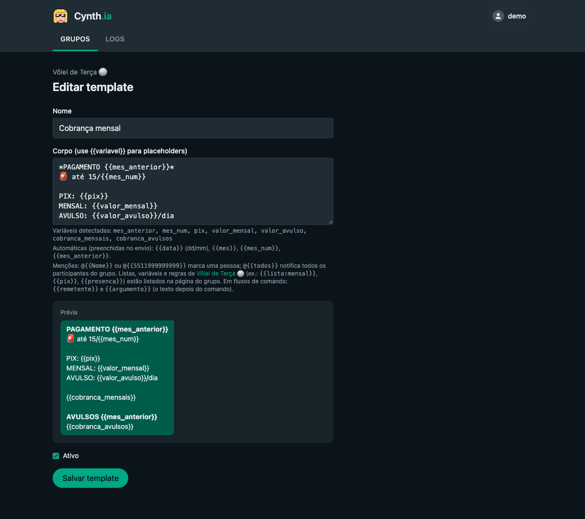
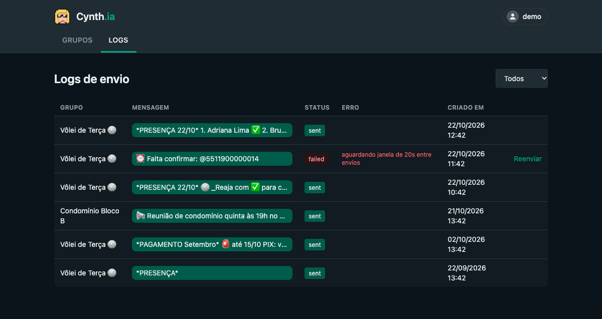
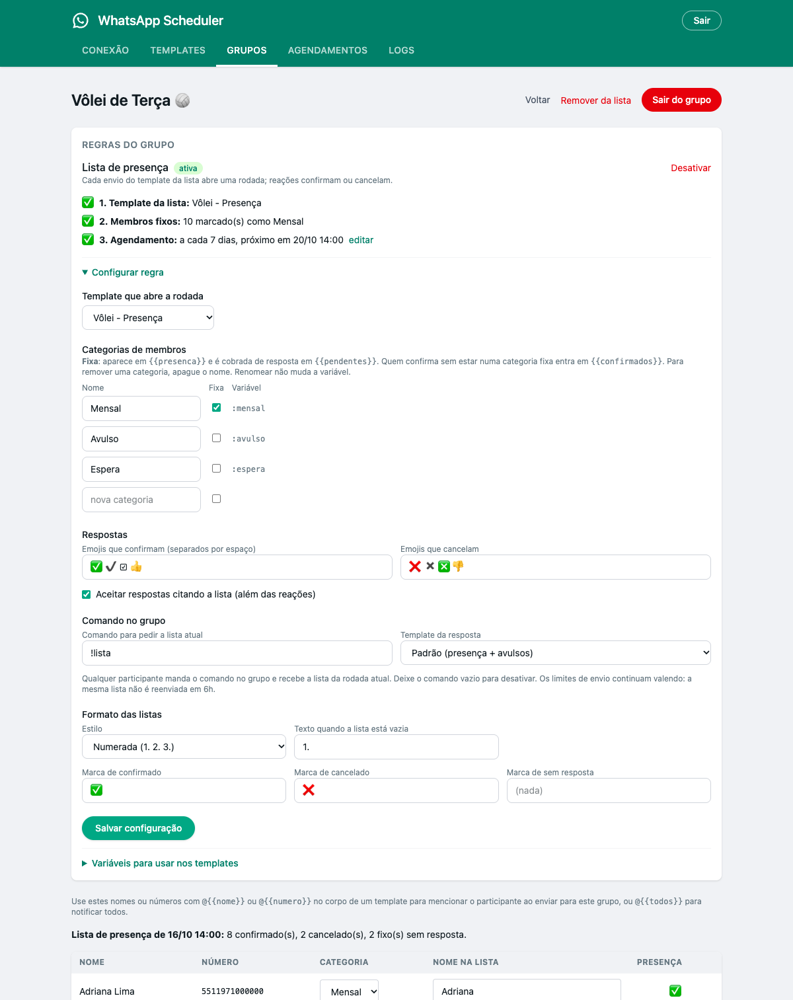
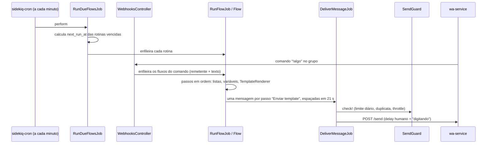
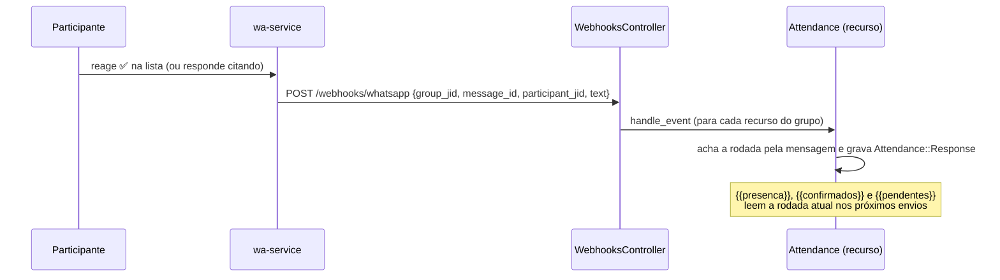
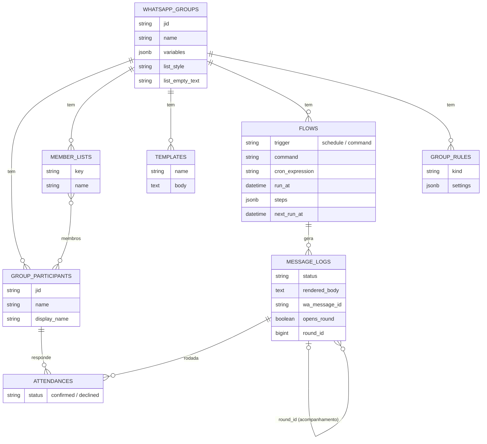

# CindyZap

**A Cindy é a assistente virtual que cuida das rotinas do seu grupo**: a "síndica" que todo grupo de
WhatsApp tem, só que automática. Painel self-hosted para **automatizar tarefas de grupos de WhatsApp**. Cada grupo tem as suas
**listas de membros**, **variáveis**, **templates** e **fluxos**: um gatilho (um horário, a "rotina", ou
um comando como `!entrar` mandado no grupo) seguido de passos, como enviar um template, pôr ou tirar
alguém de uma lista ou mudar uma variável. Recursos opcionais, como a **lista de presença**, registram
quem confirma com ✅ ou cancela com ❌ reagindo à mensagem.

Nasceu para automatizar um grupo de vôlei: toda terça uma rotina manda a lista de presença com os
mensalistas marcados, as reações viram confirmações, um lembrete marca quem ainda não respondeu,
`!lista` mostra a lista atual e, no início do mês, sai a cobrança.


> [!WARNING]
> O envio usa o [Baileys](https://github.com/WhiskeySockets/Baileys), uma biblioteca **não oficial**
> do WhatsApp Web. Isso viola os Termos de Serviço do WhatsApp e pode levar ao **bloqueio do número**.
> Use um número secundário. O sistema tem limites anti-spam (veja [Proteções de envio](#proteções-de-envio)),
> mas eles reduzem o risco, não o eliminam.

## Sumário

- [Funcionalidades](#funcionalidades)
- [Telas](#telas)
- [Arquitetura](#arquitetura)
- [Como rodar](#como-rodar)
- [Guia de uso](#guia-de-uso)
- [Criando um novo recurso de grupo](#criando-um-novo-recurso-de-grupo)
- [API interna do wa-service](#api-interna-do-wa-service)
- [Desenvolvimento](#desenvolvimento)
- [Limitações conhecidas](#limitações-conhecidas)

## Funcionalidades

**Geral**

- **Conexão** com o WhatsApp por QR Code. Se a sessão for revogada, um QR novo é gerado sozinho.
- **Grupos** sincronizados a cada 30 minutos, com participantes. Dá para sair de um grupo ou removê-lo
  do painel, um por vez ou vários de uma vez (a saída em lote roda em segundo plano, com intervalo
  entre cada grupo).
- **Logs** de cada envio, com status, erro e reenvio.
- **Login** por sessão e interface **responsiva** (no celular, tabelas viram cartões).

**Por grupo** (tudo fica na página do grupo, e cada grupo configura do seu jeito)

- **Listas de membros** (ex.: mensal, espera, pagou). Uma pessoa pode estar em várias. Nos templates
  elas aparecem como `{{lista:chave}}` (nomes) e `{{mencoes:chave}}` (marca as pessoas).
- **Variáveis**: valores como `{{pix}}` ou `{{local}}`, que os fluxos também podem alterar.
- **Templates** com variáveis, variáveis automáticas de data, menções (`@{{Caio}}`), menção a todos
  (`@{{todos}}`) e prévia ao vivo com a formatação do WhatsApp (`*negrito*`, `_itálico_`, `~riscado~`).
- **Fluxos**: gatilho + passos em ordem. Fluxo de horário (rotina) é recorrente (cron, com fuso) ou de
  envio único; fluxo de comando roda quando alguém manda `!algo` no grupo. Botão "Executar agora".
- **Recursos** opcionais: **Lista de presença**. Cada mensagem de um passo marcado "abre rodada" abre
  uma rodada; reações e respostas citando a mensagem viram confirmação ou cancelamento das listas
  cobradas.

## Telas

> Prints da versão anterior, antes de templates e fluxos irem para dentro de cada grupo.

| Login | Conexão |
|---|---|
|  |  |

| Grupos (com seleção em lote) | Template com prévia |
|---|---|
|  |  |

| Agendamentos | Logs |
|---|---|
|  |  |

**Configuração da regra Lista de presença**



**No celular**

<p>
  
  
  
</p>

> Os prints usam dados fictícios.

## Arquitetura

São dois serviços de aplicação mais Postgres e Redis, orquestrados pelo Docker Compose:


| Serviço | Stack | Responsabilidade |
|---|---|---|
| `rails` | Rails 8.1, Hotwire (Turbo + Stimulus), Tailwind 4, importmap | Painel, regras de negócio, webhook |
| `sidekiq` | Sidekiq 8 + sidekiq-cron (mesma imagem do Rails) | Rotinas, execução de fluxos, envio, sincronização, saída de grupos em lote |
| `wa` | Node 20, TypeScript, Express 5, Baileys 6.7 | Mantém a sessão do WhatsApp; envia, lista grupos, sai de grupos e repassa eventos |
| `db` | PostgreSQL 16 | Dados |
| `redis` | Redis 7 | Filas do Sidekiq e throttle de envio |

**Por que dois serviços?** O Baileys só existe em Node e precisa de um processo vivo segurando o
WebSocket da sessão. O Rails não guarda esse estado: ele fala com o `wa-service` por uma API REST
interna, protegida por `INTERNAL_API_TOKEN`. O caminho inverso (reações e respostas recebidas) chega
ao Rails por um webhook protegido pelo mesmo token.

### Fluxo de envio



### Fluxo da lista de presença



### Núcleo × recursos do grupo

O núcleo (grupos, listas, templates, fluxos, envio, webhook) **não sabe nada de presença**. Recursos
são linhas em `group_rules` (`kind` + `settings` em JSON) e cada `kind` é implementado por um módulo. O
núcleo só chama esses ganchos:

| Gancho | Quando é chamado |
|---|---|
| `provides_variable?(rule, key)` | ao validar um fluxo: a variável é deste recurso? |
| `render_variable(rule, key, mentions)` | ao renderizar um template para o grupo |
| `prepare_message(rule, message_log, template)` | antes de salvar cada mensagem enviada ao grupo |
| `handle_event(rule, event)` | quando chega uma reação ou resposta no grupo |
| `settings_from(params)` | ao salvar o formulário do recurso |

Hoje existe um recurso, a **Lista de presença** (`app/models/attendance.rb`). Veja
[Criando um novo recurso de grupo](#criando-um-novo-recurso-de-grupo). Os passos de fluxo ficam em
`Flow::STEPS` (`app/models/flow.rb`): um passo novo é uma entrada ali e um `when` em `Flow#run!`.

### Modelo de dados



### Proteções de envio

O `SendGuard` bloqueia o envio antes de chegar ao WhatsApp:

| Proteção | Valor |
|---|---|
| Limite diário de envios | 50 |
| Intervalo mínimo entre envios | 20 s (lock no Redis) |
| Mensagem idêntica no mesmo grupo | bloqueada por 6 h |
| Antes de cada envio (`wa-service`) | "digitando…" por 2 s + espera aleatória de 3 a 12 s |
| Saída de grupos em lote | 3 a 8 s entre cada grupo |

### Jobs agendados

| Job | Frequência | O que faz |
|---|---|---|
| `RunDueFlowsJob` | a cada minuto | Enfileira as rotinas com `next_run_at` vencido e calcula a próxima |
| `SyncGroupsJob` | a cada 30 min | Atualiza grupos e participantes |
| `RunFlowJob` | sob demanda | Executa os passos de um fluxo (rotina, comando ou "Executar agora") |
| `DeliverMessageJob` | sob demanda | Passa pelo `SendGuard`, envia e registra o log |
| `LeaveGroupsJob` | sob demanda | Sai de vários grupos, um por vez |

## Como rodar

### Requisitos

- Docker e Docker Compose
- Um número de WhatsApp **secundário** para escanear o QR Code

### Passo a passo

```bash
git clone git@github.com:caiovitorsantos/cindyzap.git
cd cindyzap
cp .env.example .env
```

Preencha o `.env`:

| Variável | Para que serve |
|---|---|
| `INTERNAL_API_TOKEN` | Token entre Rails e wa-service. Gere com `ruby -rsecurerandom -e "puts SecureRandom.hex(32)"` |
| `RAILS_MASTER_KEY` | Conteúdo de `rails-app/config/master.key` |
| `ADMIN_USERNAME` / `ADMIN_PASSWORD` | Login do painel |
| `DATABASE_URL`, `REDIS_URL`, `WA_SERVICE_URL` | Já vêm prontos para o Docker Compose |

Suba tudo e prepare o banco:

```bash
docker compose up -d --build
docker compose exec rails bin/rails db:prepare
```

Abra **http://localhost:3000**, entre com o usuário e a senha do `.env` e, na aba **Conexão**,
escaneie o QR Code pelo celular (WhatsApp → Dispositivos conectados → Conectar dispositivo).

O `wa` e o `sidekiq` sobem com `restart: unless-stopped`: voltam sozinhos se caírem ou se o Docker
reiniciar.

## Guia de uso

Tudo acontece na página do grupo (**Grupos** → nome do grupo), dividida em Fluxos, Templates, Membros e
listas, Variáveis e Recursos.

### 1. Listas de membros e variáveis

Em **Membros e listas**, crie as listas (ex.: Mensal, Espera) e marque, na tabela de membros, em quais
listas cada pessoa está. "Nome nas listas" troca o nome exibido. A chave da lista (`mensal`) é o que os
templates usam; renomear a lista não quebra nada. O formato (numerada, `•`, `-` ou sem marcador) e o
texto de lista vazia valem para todas as listas do grupo.

| Variável | Saída |
|---|---|
| `{{lista:mensal}}` | `1. Adriana`<br>`2. Bruno` |
| `{{mencoes:mensal}}` | `1. @Adriana`<br>`2. @Bruno` (notifica) |

Em **Variáveis**, guarde pares nome → valor (ex.: `pix`), usados como `{{pix}}`.

### 2. Templates

| Variável | Valor |
|---|---|
| `{{qualquer_nome}}` | Variável do grupo |
| `{{data}}` | Data do envio (`dd/mm`) |
| `{{mes}}`, `{{mes_num}}`, `{{mes_anterior}}` | `Outubro`, `10`, `Setembro` |
| `{{remetente}}`, `{{argumento}}` | Em fluxos de comando: quem mandou e o texto depois do comando |
| `@{{Caio}}` ou `@{{5511999999999}}` | Menciona o participante (pelo nome exato ou pelo número) |
| `@{{todos}}` (ou `@{{all}}`) | Mostra "@todos" e notifica **todos** os participantes sincronizados |

As datas usam o fuso do fluxo. Recursos ativos oferecem variáveis extras (abaixo).

### 3. Fluxos

**Nova rotina** cria um fluxo de horário: informe **ou** um cron **ou** uma data de envio único
("Pré-visualizar" mostra os próximos disparos). **Novo comando** cria um fluxo disparado por uma
palavra começando com `!`, mandada por qualquer participante (inclusive o dono do número conectado).

| Cron | Quando |
|---|---|
| `0 14 * * 2` | Toda terça às 14h |
| `0 9 1 * *` | Dia 1 de cada mês às 9h |
| `0 9 * * 1-5` | Dias úteis às 9h |

Passos disponíveis:

| Passo | O que faz |
|---|---|
| Enviar template | Renderiza e envia. Marcado "abre rodada de presença", abre uma rodada |
| Pôr quem mandou o comando numa lista | Só em fluxos de comando |
| Tirar quem mandou o comando de uma lista | Só em fluxos de comando |
| Esvaziar lista | Tira todo mundo da lista |
| Definir variável do grupo | O valor aceita variáveis, ex.: `{{argumento}}` |

Mensagens de fluxos de comando saem assinadas com `_🤖 Cindy_` no fim, para o grupo saber que quem
respondeu foi a assistente. Rotinas saem sem assinatura.

Os passos rodam em ordem, então um template enviado depois de "Pôr na lista" já sai com a lista
atualizada. Mensagens seguidas saem com ~21 s de intervalo (limite do `SendGuard`). Um fluxo que usa
uma variável que ninguém oferece é recusado ao salvar.

### 4. Recurso "Lista de presença"

Em **Recursos**, clique em **Ativar**. O checklist mostra o que falta:

1. **Listas cobradas**: as listas que aparecem em `{{presenca}}` e são cobradas em `{{pendentes}}`.
2. **Fluxo que abre a rodada**: uma rotina com um passo "Enviar template" marcado "abre rodada".

Em **Configurar**: listas cobradas, emojis que confirmam/cancelam (`✅ ✔ ☑ 👍` / `❌ ✖ ❎ 👎`), se
respostas citando a mensagem contam, e as marcas de confirmado/cancelado/sem resposta.

| Variável | Sem chave de lista | Exemplo de saída |
|---|---|---|
| `{{lista}}` | nomes das listas cobradas | `1. Adriana`<br>`2. Bruno` |
| `{{mencoes}}` | marca as listas cobradas | `1. @Adriana`<br>`2. @Bruno` |
| `{{presenca}}` | listas cobradas com a marca da resposta | `1. Adriana ✅`<br>`2. Bruno ❌`<br>`3. Carla` |
| `{{confirmados}}` | quem confirmou fora das listas cobradas | `1. Ellie` |
| `{{pendentes}}` | marca quem das listas cobradas não respondeu | `@Carla @Igor` |

Todas aceitam uma lista específica, como em `{{presenca:espera}}`. Reações em mensagens que mostram a
rodada (um lembrete com `{{pendentes}}`, a resposta ao `!lista`) também contam para a mesma rodada.

### Exemplo completo: grupo de vôlei

Listas `mensal` (cobrada pela presença) e `espera`; variáveis `pix` e `valor_mensal`.

| Fluxo | Gatilho | Passos |
|---|---|---|
| Presença | `0 14 * * 2` | Enviar "Presença" (`*PRESENÇA {{data}}*`<br>`{{mencoes}}`), **abre rodada** |
| Lembrete | `0 16 * * 2` | Enviar "Lembrete" (`⏰ Falta confirmar: {{pendentes}}`) |
| Lista | `!lista` | Enviar "Lista atual" (`{{presenca}}`<br>`*Avulsos*`<br>`{{confirmados}}`) |
| Entrar na espera | `!espera` | Pôr quem mandou na lista `espera`; enviar "Espera" (`{{lista:espera}}`) |
| Nova semana | `0 23 * * 2` | Esvaziar lista `espera` |
| Cobrança | `0 9 1 * *` | Enviar "Cobrança" (`PIX: {{pix}}`<br>`MENSAL: {{valor_mensal}}`<br>`{{mencoes}}`) |

## Criando um novo recurso de grupo

1. Crie um módulo em `app/models/<recurso>.rb` que responda aos ganchos da tabela
   [Núcleo × recursos do grupo](#núcleo--recursos-do-grupo). Use `app/models/attendance.rb` como modelo.
2. Registre-o em `GroupRule::HANDLERS` e `GroupRule::NAMES` (`app/models/group_rule.rb`).
3. Crie o bloco em `app/views/group_rules/_<kind>.html.erb` e renderize-o na seção Recursos da página
   do grupo (`app/views/groups/show.html.erb`).
4. Guarde as configurações em `rule.settings` (JSON). Tabelas próprias só se precisar guardar dados,
   como `attendances` na Lista de presença.

## API interna do wa-service

Base: `WA_SERVICE_URL` (`http://wa:3001` no Compose). Todas as rotas, exceto `/health`, exigem o
header `Authorization: <INTERNAL_API_TOKEN>`.

| Método | Rota | Descrição |
|---|---|---|
| `GET` | `/health` | `{status, connected}`; status é `connected`, `qr_pending` ou `disconnected` |
| `GET` | `/qr` | QR Code atual (data URL) |
| `GET` | `/groups` | Grupos com participantes (`jid`, `name`) |
| `POST` | `/send` | `{group_jid, message, mentions?}` → `{status, message_id}` |
| `POST` | `/groups/leave` | `{group_jid}`: sai do grupo |
| `POST` | `/logout` | Encerra a sessão e gera um novo QR |

**Webhook (wa-service → Rails):** `POST RAILS_WEBHOOK_URL` (`/webhooks/whatsapp`) com
`{kind: "reaction" | "reply" | "command", group_jid, message_id, participant_jid, push_name, text}`.
Uma reação removida chega com `text` vazio. Mensagens que começam com `!` chegam como `command`.

## Desenvolvimento

```bash
# Testes e lint (RSpec + RuboCop)
docker compose run --rm -e RAILS_ENV=test rails bash -c "bin/rails db:prepare && bundle exec rspec && bin/rubocop"

# Checagem de tipos do wa-service
docker compose exec wa npx tsc --noEmit -p .

# Recompilar o CSS depois de usar classes novas do Tailwind (o container não roda o watch)
docker compose exec rails bin/rails tailwindcss:build

# Migrations
docker compose exec rails bin/rails db:migrate
```

O `wa-service` roda com `tsx watch`: mudanças em `wa-service/src` recarregam sozinhas.

### Estrutura

```
.
├── docker-compose.yml
├── rails-app/
│   ├── app/
│   │   ├── controllers/      # painel, login, webhook, grupos, fluxos, templates, recursos
│   │   ├── jobs/             # rotinas, execução de fluxo, envio, sincronização, saída em lote
│   │   ├── models/
│   │   │   ├── flow.rb             # fluxos: gatilhos e passos (componentes)
│   │   │   ├── member_list.rb      # listas de membros
│   │   │   ├── group_rule.rb       # registro de recursos por grupo
│   │   │   └── attendance.rb       # recurso "Lista de presença"
│   │   ├── services/         # TemplateRenderer, SendGuard, WaClient, ScheduleCalculator
│   │   └── views/
│   ├── config/schedule.yml   # cron do sidekiq-cron
│   └── spec/                 # RSpec
├── wa-service/src/
│   ├── server.ts             # API REST interna
│   └── whatsapp.ts           # sessão Baileys, QR, eventos → webhook
└── docs/screenshots/
```

## Limitações conhecidas

- **Risco de bloqueio** do número, inerente ao uso do Baileys.
- **Lista copiada e colada não é lida.** Só reações e respostas citando a mensagem viram confirmação.
- **Uma rodada aberta por grupo:** a última mensagem enviada que abre rodada.
- **Lembrete sem pendentes sai mesmo assim**, com `{{pendentes}}` vazio.
- **Fluxo que falha no meio não é repetido** (para não duplicar envios); o erro fica no Sidekiq.
- **Gatilhos são só horário e comando.** Entrada/saída de membros no grupo ainda não dispara fluxos.
- **Admin único**, com credenciais no `.env`.
