<p align="center">
  
</p>

# Cynth.ia

**A Cynth.ia é a administradora de grupos de WhatsApp que faz o trabalho chato. De má vontade, mas
faz.** Ela é a "síndica" que todo grupo tem, só que automática, entediada e de óculos.

**A voz dela.** Seca, irônica e entediada, mas sempre resolve: frases curtas, suspiros, um "uau" sem
emoção nenhuma, e nada de pontos de exclamação animados. No painel, as confirmações aparecem como
mensagem dela ("Fluxo criado. Mais trabalho pra mim. Ótimo."). Em ações destrutivas e erros, a
informação vem primeiro e a ironia depois. Quem escrever textos novos no painel deve manter esse tom.

Painel self-hosted para **automatizar tarefas de grupos de WhatsApp**. Cada grupo tem as suas
**listas de membros**, **variáveis**, **templates** e **fluxos**: um gatilho (um horário, a "rotina", ou
um comando como `!entrar` mandado no grupo) seguido de passos, como enviar um template, pôr ou tirar
alguém de uma lista ou mudar uma variável. Regras opcionais cuidam da **lista de presença** (✅/❌ na
mensagem ou a lista copiada e colada) e da **cobrança mensal** (💰).

Nasceu para automatizar um grupo de vôlei: toda terça uma rotina manda a lista de presença com os
mensalistas marcados, as reações viram confirmações, um lembrete marca quem ainda não respondeu,
`!lista` mostra a lista atual e, no início do mês, sai a cobrança.

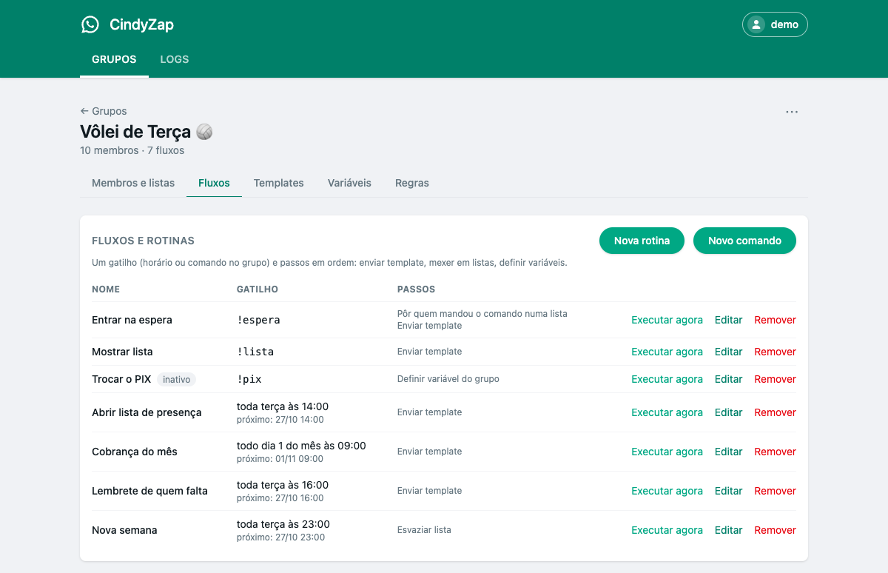

> [!WARNING]
> O envio usa o [Baileys](https://github.com/WhiskeySockets/Baileys), uma biblioteca **não oficial**
> do WhatsApp Web. Isso viola os Termos de Serviço do WhatsApp e pode levar ao **bloqueio do número**.
> Use um número secundário. O sistema tem limites anti-spam (veja [Proteções de envio](#proteções-de-envio)),
> mas eles reduzem o risco, não o eliminam.

## Sumário

- [Funcionalidades](#funcionalidades)
- [Telas](#telas)
- [Arquitetura](#arquitetura)
- [Como rodar](#como-rodar)
- [Guia de uso](#guia-de-uso)
- [Criando uma nova regra de grupo](#criando-uma-nova-regra-de-grupo)
- [API interna do wa-service](#api-interna-do-wa-service)
- [Desenvolvimento](#desenvolvimento)
- [Limitações conhecidas](#limitações-conhecidas)

## Funcionalidades

**Geral**

- **Conta**: o botão com o usuário, no canto do cabeçalho, abre o status da conexão com o WhatsApp
  (QR Code para conectar; se a sessão for revogada, um QR novo é gerado sozinho) e o botão de sair.
- **Grupos** sincronizados a cada 30 minutos, com participantes. Dá para sair de um grupo ou removê-lo
  do painel, um por vez ou vários de uma vez (a saída em lote roda em segundo plano, com intervalo
  entre cada grupo).
- **Logs** de cada envio, com status, erro e reenvio.
- **Login** por sessão, **página inicial** de apresentação para quem não está logado e interface
  **responsiva** (no celular, tabelas viram cartões), no tema escuro do WhatsApp.
- **Português, inglês e espanhol**: o painel segue o idioma do navegador e pode ser trocado no
  cabeçalho (PT · EN · ES) ou no modal da conta. Cada grupo tem também o idioma das mensagens que a
  Cynth.ia gera sozinha (nomes de mês e assinatura padrão).

**Por grupo** (tudo fica na página do grupo, e cada grupo configura do seu jeito)

- **Listas de membros** (ex.: mensal, espera, pagou). Uma pessoa pode estar em várias. Nos templates
  elas aparecem como `{{lista:chave}}` (nomes) e `{{mencoes:chave}}` (marca as pessoas).
- **Variáveis**: valores como `{{pix}}` ou `{{local}}`, que os fluxos também podem alterar.
- **Templates** com variáveis, variáveis automáticas de data, menções (`@{{Caio}}`), menção a todos
  (`@{{todos}}`) e prévia ao vivo com a formatação do WhatsApp (`*negrito*`, `_itálico_`, `~riscado~`).
- **Fluxos**: gatilho + passos em ordem. Fluxo de horário (rotina) é recorrente (cron, com fuso) ou de
  envio único; fluxo de comando roda quando alguém manda `!algo` no grupo. Botão "Executar agora".
- **Regras** opcionais: **Cobrança mensal** (mensalidades e diárias de avulsos, pagamento marcado
  com 💰) e **Lista de presença**. Cada mensagem de um passo marcado "abre rodada" abre
  uma rodada; reações e respostas citando a mensagem viram confirmação ou cancelamento das listas
  cobradas.

## Telas

**Página inicial** (para quem não está logado)

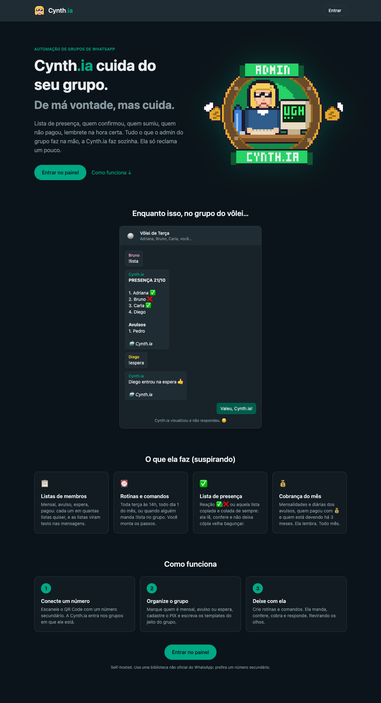

| Login | Conta (status do WhatsApp e sair) |
|---|---|
|  | 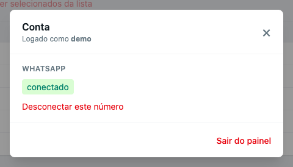 |

| Grupos (ações em lote aparecem ao marcar) | Logs |
|---|---|
|  |  |

**Membros e listas do grupo**

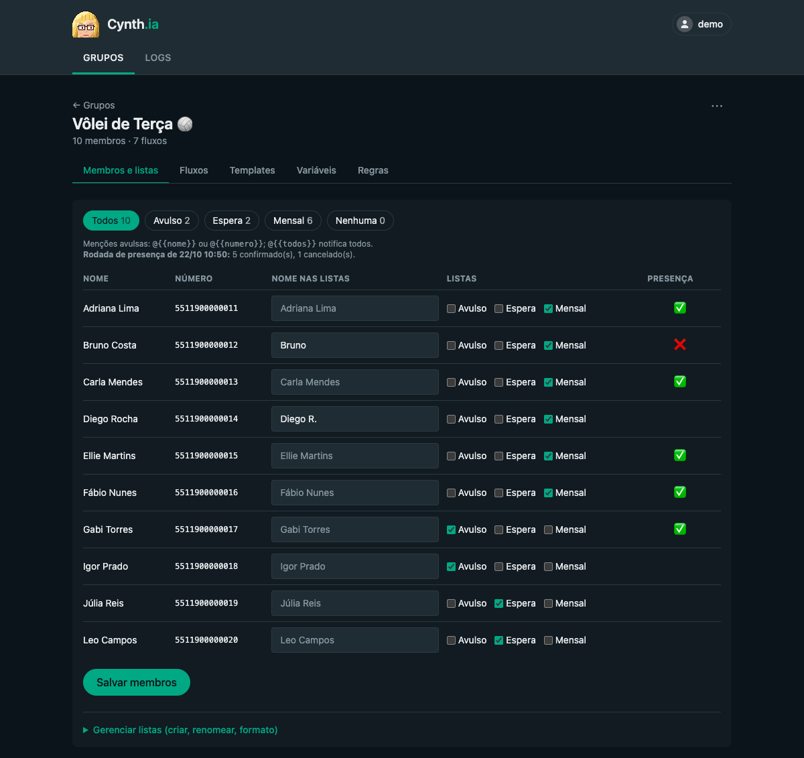

| Fluxo de comando (`!espera`) | Rotina (cobrança do mês) |
|---|---|
| 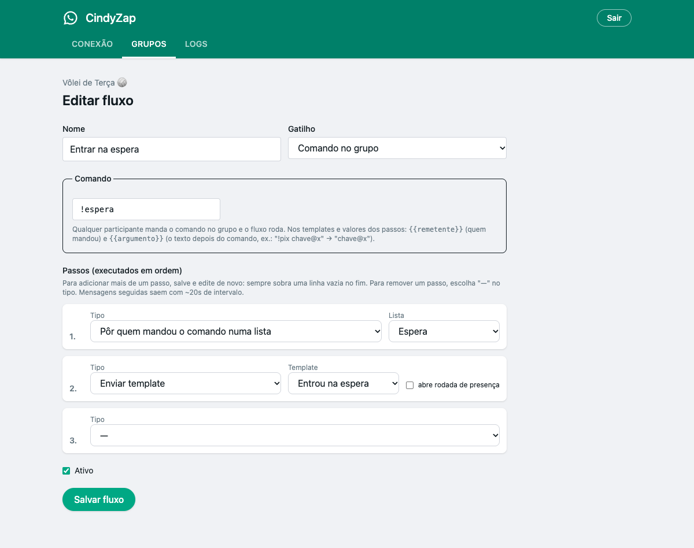 | 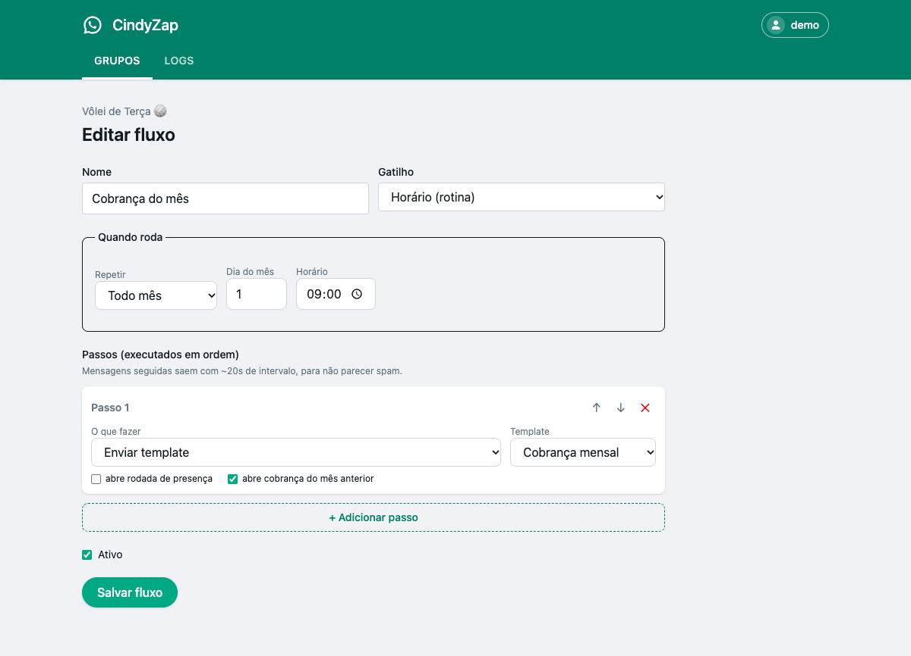 |

| Template com prévia | Regras: presença e cobrança mensal |
|---|---|
|  | 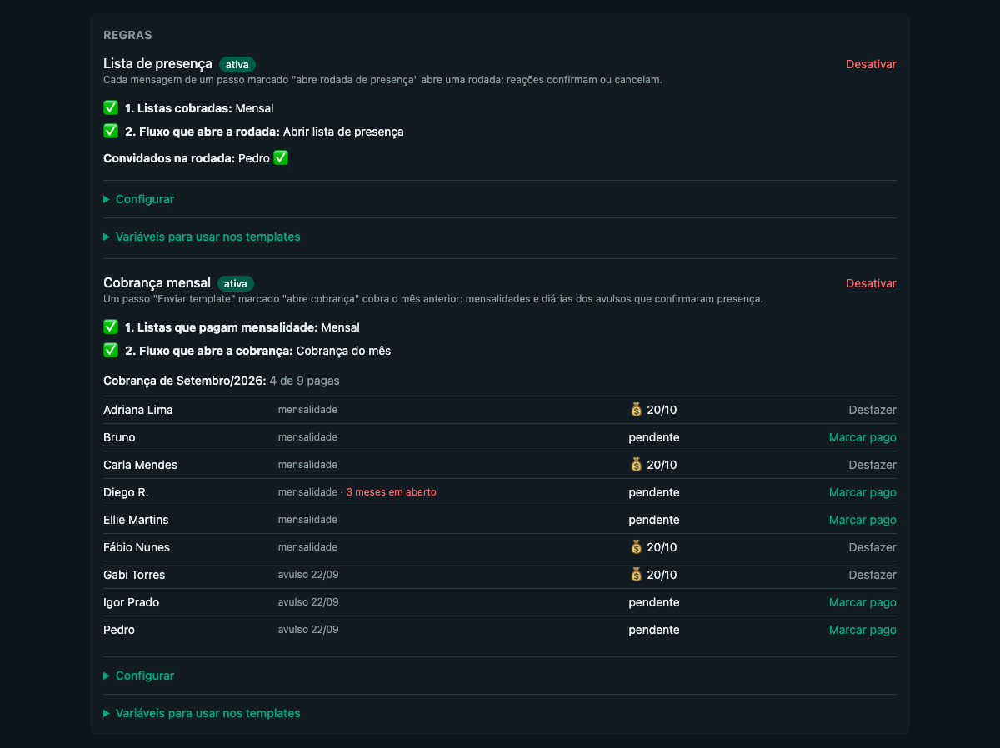 |

**No celular**

<p>
  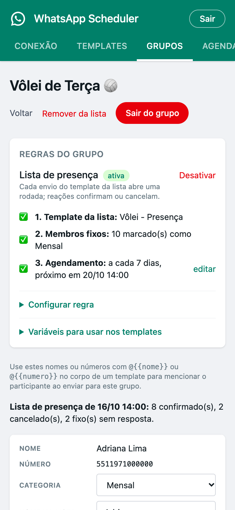
  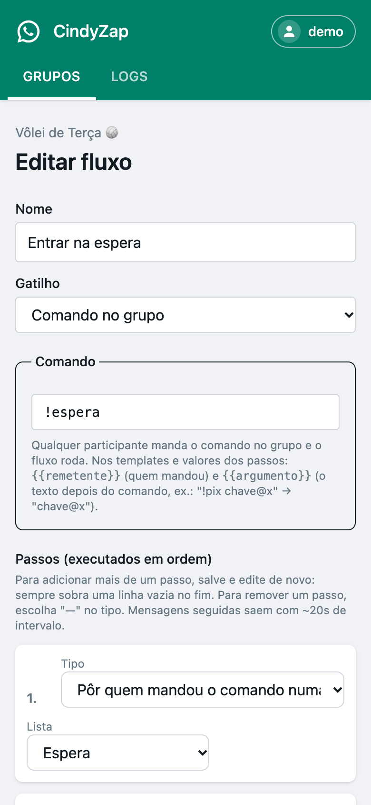
  
</p>

> Os prints usam dados fictícios.

## Arquitetura

São dois serviços de aplicação mais Postgres e Redis, orquestrados pelo Docker Compose:


| Serviço | Stack | Responsabilidade |
|---|---|---|
| `rails` | Rails 8.1, Hotwire (Turbo + Stimulus), Tailwind 4, importmap | Painel, regras de negócio, webhook |
| `sidekiq` | Sidekiq 8 + sidekiq-cron (mesma imagem do Rails) | Rotinas, execução de fluxos, envio, sincronização, saída de grupos em lote |
| `wa` | Node 20, TypeScript, Express 5, Baileys 6.7 | Mantém a sessão do WhatsApp; envia, lista grupos, sai de grupos e repassa eventos |
| `db` | PostgreSQL 16 | Dados |
| `redis` | Redis 7 | Filas do Sidekiq e throttle de envio |

**Por que dois serviços?** O Baileys só existe em Node e precisa de um processo vivo segurando o
WebSocket da sessão. O Rails não guarda esse estado: ele fala com o `wa-service` por uma API REST
interna, protegida por `INTERNAL_API_TOKEN`. O caminho inverso (reações e respostas recebidas) chega
ao Rails por um webhook protegido pelo mesmo token.

### Fluxo de envio

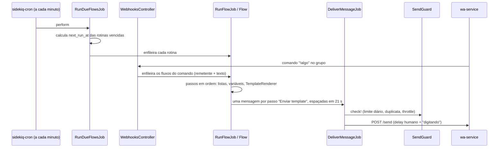

### Fluxo da lista de presença

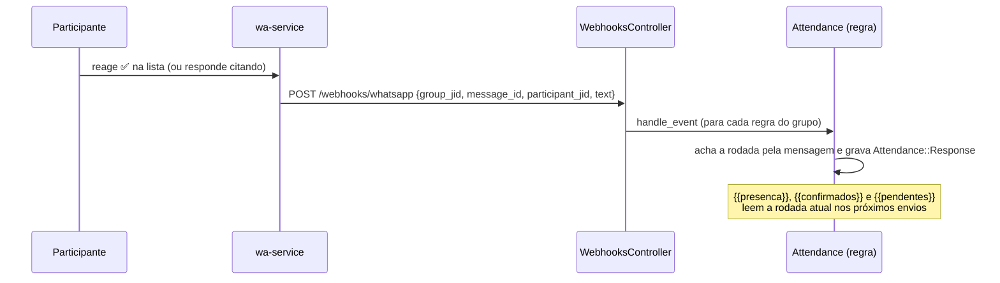

### Núcleo × regras do grupo

O núcleo (grupos, listas, templates, fluxos, envio, webhook) **não sabe nada de presença**. Regras
são linhas em `group_rules` (`kind` + `settings` em JSON) e cada `kind` é implementado por um módulo. O
núcleo só chama esses ganchos:

| Gancho | Quando é chamado |
|---|---|
| `provides_variable?(rule, key)` | ao validar um fluxo: a variável é desta regra? |
| `render_variable(rule, key, mentions)` | ao renderizar um template para o grupo |
| `before_message(rule, step, now)` | antes de renderizar um passo "Enviar template" (ex.: abre a cobrança) |
| `prepare_message(rule, message_log, template)` | antes de salvar cada mensagem enviada ao grupo |
| `handle_event(rule, event)` | quando chega uma reação, resposta ou lista colada no grupo |
| `settings_from(params)` | ao salvar o formulário da regra |

Hoje existem duas regras: **Lista de presença** (`app/models/attendance.rb`) e **Cobrança mensal**
(`app/models/billing.rb`). Veja
[Criando uma nova regra de grupo](#criando-uma-nova-regra-de-grupo). Os passos de fluxo ficam em
`Flow::STEPS` (`app/models/flow.rb`): um passo novo é uma entrada ali e um `when` em `Flow#run!`.

### Modelo de dados

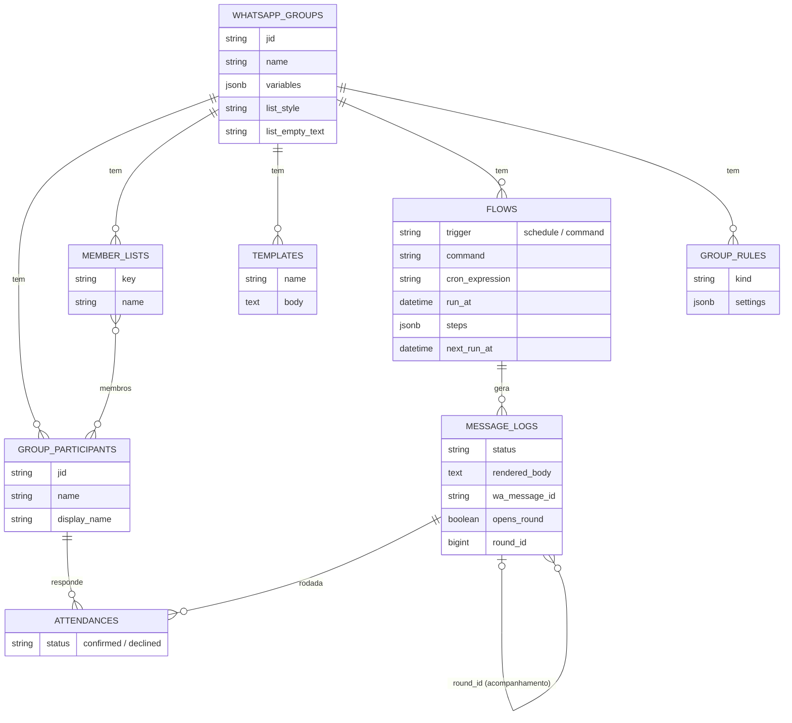

### Proteções de envio

O `SendGuard` bloqueia o envio antes de chegar ao WhatsApp:

| Proteção | Valor |
|---|---|
| Limite diário de envios | 50 |
| Intervalo mínimo entre envios | 20 s (lock no Redis) |
| Mensagem idêntica no mesmo grupo | bloqueada por 6 h |
| Antes de cada envio (`wa-service`) | "digitando…" por 2 s + espera aleatória de 3 a 12 s |
| Saída de grupos em lote | 3 a 8 s entre cada grupo |

### Jobs agendados

| Job | Frequência | O que faz |
|---|---|---|
| `RunDueFlowsJob` | a cada minuto | Enfileira as rotinas com `next_run_at` vencido e calcula a próxima |
| `SyncGroupsJob` | a cada 30 min | Atualiza grupos e participantes |
| `RunFlowJob` | sob demanda | Executa os passos de um fluxo (rotina, comando ou "Executar agora") |
| `DeliverMessageJob` | sob demanda | Passa pelo `SendGuard`, envia e registra o log |
| `LeaveGroupsJob` | sob demanda | Sai de vários grupos, um por vez |

## Como rodar

### Requisitos

- Docker e Docker Compose
- Um número de WhatsApp **secundário** para escanear o QR Code

### Passo a passo

```bash
git clone git@github.com:caiovitorsantos/cynthia.git
cd cynthia
cp .env.example .env
```

Preencha o `.env`:

| Variável | Para que serve |
|---|---|
| `INTERNAL_API_TOKEN` | Token entre Rails e wa-service. Gere com `ruby -rsecurerandom -e "puts SecureRandom.hex(32)"` |
| `RAILS_MASTER_KEY` | Conteúdo de `rails-app/config/master.key` |
| `ADMIN_USERNAME` / `ADMIN_PASSWORD` | Login do painel |
| `DATABASE_URL`, `REDIS_URL`, `WA_SERVICE_URL` | Já vêm prontos para o Docker Compose |

Suba tudo e prepare o banco:

```bash
docker compose up -d --build
docker compose exec rails bin/rails db:prepare
```

Abra **http://localhost:3000**, entre com o usuário e a senha do `.env`, clique no seu usuário no canto do cabeçalho e
escaneie o QR Code pelo celular (WhatsApp → Dispositivos conectados → Conectar dispositivo).

O `wa` e o `sidekiq` sobem com `restart: unless-stopped`: voltam sozinhos se caírem ou se o Docker
reiniciar.

## Guia de uso

Tudo acontece na página do grupo (**Grupos** → nome do grupo), dividida em abas: **Membros e listas**,
Fluxos, Templates, Variáveis e Regras. A aba fica na URL (ex.: `#fluxos`). Remover o grupo do painel e
sair dele no WhatsApp ficam no menu **⋯**.

### 1. Listas de membros e variáveis

Em **Membros e listas**, marque na tabela em quais listas cada pessoa está; o filtro no topo mostra
quem está em cada lista (ou em nenhuma). Crie, renomeie e formate listas em "Gerenciar listas". "Nome nas listas" troca o nome exibido. A chave da lista (`mensal`) é o que os
templates usam; renomear a lista não quebra nada. O formato (numerada, `•`, `-` ou sem marcador) e o
texto de lista vazia valem para todas as listas do grupo.

| Variável | Saída |
|---|---|
| `{{lista:mensal}}` | `1. Adriana`<br>`2. Bruno` |
| `{{mencoes:mensal}}` | `1. @Adriana`<br>`2. @Bruno` (notifica) |

Em **Variáveis**, guarde pares nome → valor (ex.: `pix`), usados como `{{pix}}`. Ali também ficam a
assinatura da Cynth.ia e o **idioma das mensagens no grupo**, que vale para `{{mes}}`/`{{mes_anterior}}`
e para a assinatura padrão. Os nomes das variáveis (`{{presenca}}`, `{{remetente}}` etc.) são os mesmos
em qualquer idioma.

### 2. Templates

| Variável | Valor |
|---|---|
| `{{qualquer_nome}}` | Variável do grupo |
| `{{data}}` | Data do envio (`dd/mm`) |
| `{{mes}}`, `{{mes_num}}`, `{{mes_anterior}}` | `Outubro`, `10`, `Setembro` |
| `{{remetente}}`, `{{argumento}}` | Em fluxos de comando: quem mandou e o texto depois do comando |
| `@{{Caio}}` ou `@{{5511999999999}}` | Menciona o participante (pelo nome exato ou pelo número) |
| `@{{todos}}` (ou `@{{all}}`) | Mostra "@todos" e notifica **todos** os participantes sincronizados |

As datas usam o fuso do fluxo. Regras ativas oferecem variáveis extras (abaixo).

### 3. Fluxos

**Nova rotina** cria um fluxo de horário. Em "Repetir", escolha **uma vez** (data e hora), **todo dia**,
**toda semana** (marque os dias) ou **todo mês** (dia do mês), mais o horário. Quem precisa de algo
diferente usa **Avançado (cron)**, com "Ver próximos envios". Na lista de fluxos o horário aparece por
extenso, como "toda terça às 14:00". **Novo comando** cria um fluxo disparado por uma palavra começando
com `!`, mandada por qualquer participante (inclusive o dono do número conectado).

Os passos são montados no próprio formulário: **+ Adicionar passo**, ↑/↓ para reordenar e ✕ para remover.

Passos disponíveis:

| Passo | O que faz |
|---|---|
| Enviar template | Renderiza e envia. Marcado "abre rodada de presença", abre uma rodada |
| Pôr quem mandou o comando numa lista | Só em fluxos de comando |
| Tirar quem mandou o comando de uma lista | Só em fluxos de comando |
| Esvaziar lista | Tira todo mundo da lista |
| Definir variável do grupo | O valor aceita variáveis, ex.: `{{argumento}}` |

Mensagens de fluxos de comando saem com a assinatura do grupo no fim, para o grupo saber que quem
respondeu foi a assistente. Várias opções separadas por `|` são sorteadas a cada mensagem; o padrão é
`_😒 Cynth.ia_ | _— Cynth.ia, contra a vontade_ | _Cynth.ia. De nada, eu acho._ | _ugh. — Cynth.ia_`.
Cada grupo muda o texto na aba Variáveis; vazio não assina. Rotinas saem sem assinatura.

Os passos rodam em ordem, então um template enviado depois de "Pôr na lista" já sai com a lista
atualizada. Mensagens seguidas saem com ~21 s de intervalo (limite do `SendGuard`). Um fluxo que usa
uma variável que ninguém oferece é recusado ao salvar.

### 4. Regra "Lista de presença"

Em **Regras**, clique em **Ativar**. O checklist mostra o que falta:

1. **Listas cobradas**: as listas que aparecem em `{{presenca}}` e são cobradas em `{{pendentes}}`.
2. **Fluxo que abre a rodada**: uma rotina com um passo "Enviar template" marcado "abre rodada".

Em **Configurar**: listas cobradas, emojis que confirmam/cancelam (`✅ ✔ ☑ 👍` / `❌ ✖ ❎ 👎`), se
respostas citando a mensagem contam, e as marcas de confirmado/cancelado/sem resposta.

| Variável | Sem chave de lista | Exemplo de saída |
|---|---|---|
| `{{lista}}` | nomes das listas cobradas | `1. Adriana`<br>`2. Bruno` |
| `{{mencoes}}` | marca as listas cobradas | `1. @Adriana`<br>`2. @Bruno` |
| `{{presenca}}` | listas cobradas com a marca da resposta | `1. Adriana ✅`<br>`2. Bruno ❌`<br>`3. Carla` |
| `{{confirmados}}` | quem confirmou fora das listas cobradas | `1. Ellie` |
| `{{pendentes}}` | marca quem das listas cobradas não respondeu | `@Carla @Igor` |

**Lista copiada e colada.** O costume de copiar a lista, marcar ✅/❌ (ou pôr o nome em Avulsos) e
colar no grupo também funciona:

- A lista é reconhecida pela primeira linha, igual à da mensagem da rodada (ex.: `PRESENÇA 21/10`).
- Cada linha numerada é uma pessoa, achada pelo "Nome nas listas" ou pelo nome no WhatsApp.
- Na seção de avulsos (título configurável, padrão "Avulsos"), estar na lista já é confirmar; nomes
  sem cadastro entram como **convidados**.
- Como cópias podem estar desatualizadas, uma colagem **preenche quem ainda não respondeu**, mas só a
  **linha da própria pessoa** muda uma resposta já registrada.
- Nomes que não batem com ninguém aparecem na regra como "não reconhecidos"; preencha o "Nome nas
  listas" do membro com esse nome para associar.

Para os nomes da cópia baterem sozinhos, use `{{lista}}` ou `{{presenca}}` (nomes) no template que
abre a rodada, em vez de `{{mencoes}}`.

Todas as variáveis aceitam uma lista específica, como em `{{presenca:espera}}`. Reações em mensagens que mostram a
rodada (um lembrete com `{{pendentes}}`, a resposta ao `!lista`) também contam para a mesma rodada.

### 5. Regra "Cobrança mensal"

Em **Regras**, ative **Cobrança mensal** e marque as **listas que pagam mensalidade** (ex.: Mensal).
Numa rotina (ex.: dia 1 às 9h), marque o passo "Enviar template" como **"abre cobrança do mês
anterior"**. Antes de renderizar, ele cria:

- uma **mensalidade** para cada membro das listas que pagam;
- uma **diária** para cada dia em que alguém de fora delas confirmou presença numa rodada do mês
  (vem da Lista de presença, inclusive convidados).

| Variável | Saída |
|---|---|
| `{{cobranca_mensais}}` | `1. Adriana 💰`<br>`2. @David 3x` (marcado, com meses em atraso se deve mais de um) |
| `{{cobranca_avulsos}}` | `02/09`<br>`Ellie 💰`<br>`@Luana` (agrupado por dia jogado) |
| `{{pendentes_pagamento}}` | marca todo mundo que ainda deve (para um lembrete) |

O pagamento é marcado do jeito que o grupo já faz: alguém copia a cobrança, põe 💰 no nome e cola no
grupo (a cópia é reconhecida pela primeira linha). Também dá para marcar ou desfazer no painel. Pago
nunca volta sozinho, então cópias antigas não desfazem nada. Nomes com 💰 que não batem com ninguém
aparecem como "não reconhecidos".

### 6. Chat com a Cynth.ia

O botão com o rosto dela, no canto do painel, abre um chat. Ela tira dúvidas sobre o sistema e, se você
pedir ("cria uma rotina toda terça às 14h com a lista de presença no vôlei"), consulta o grupo e
**propõe** o template, o fluxo ou a variável num cartão com prévia. Nada é salvo até você clicar em
**Confirmar**, e a criação passa pelas mesmas validações do painel. Ela sabe em que grupo você está.

Usa o modelo Claude Haiku 5.5 (barato: centavos de dólar por mês num grupo). Para ligar, crie uma chave
em console.anthropic.com, coloque em `ANTHROPIC_API_KEY` no `.env` e reinicie o rails. Se a chave não for
de um workspace (a API avisa "not scoped to a workspace"), informe também `ANTHROPIC_WORKSPACE_ID`. Sem a chave, o
chat avisa que falta. A conversa fica no banco; "Nova conversa" apaga o histórico.

**No grupo.** Marque a Cynth.ia numa mensagem (`@Cynth.ia quem confirmou hoje?`) e ela responde ali
mesmo, marcando quem perguntou. No grupo ela só enxerga aquele grupo: presença da rodada, quem deve na
cobrança, listas, templates, fluxos e como usar os comandos.

- **Qualquer pessoa** pode perguntar.
- **Só admins** podem pedir mudanças (template, fluxo, variável). Ela responde com a prévia completa do
  que vai criar e só executa quando um admin responde **sim** citando essa mensagem.
- **Comandos `!` que mexem em dados do grupo** (definir variável, esvaziar lista) só rodam para admins;
  consultas como `!lista` e entrar/sair da própria lista (`!espera`) valem para todos.
- Até 20 respostas por hora por grupo, e as respostas passam pelos limites anti-spam.

### Exemplo completo: grupo de vôlei

Listas `mensal` (cobrada pela presença) e `espera`; variáveis `pix` e `valor_mensal`.

| Fluxo | Gatilho | Passos |
|---|---|---|
| Presença | `0 14 * * 2` | Enviar "Presença" (`*PRESENÇA {{data}}*`<br>`{{mencoes}}`), **abre rodada** |
| Lembrete | `0 16 * * 2` | Enviar "Lembrete" (`⏰ Falta confirmar: {{pendentes}}`) |
| Lista | `!lista` | Enviar "Lista atual" (`{{presenca}}`<br>`*Avulsos*`<br>`{{confirmados}}`) |
| Entrar na espera | `!espera` | Pôr quem mandou na lista `espera`; enviar "Espera" (`{{lista:espera}}`) |
| Nova semana | `0 23 * * 2` | Esvaziar lista `espera` |
| Cobrança | `0 9 1 * *` | Enviar "Cobrança" (`*PAGAMENTO {{mes_anterior}}*`<br>`PIX: {{pix}}`<br>`{{cobranca_mensais}}`<br>`*AVULSOS*`<br>`{{cobranca_avulsos}}`), **abre cobrança** |
| Lembrete de pagamento | `0 9 10 * *` | Enviar "Falta pagar" (`💸 Falta pagar: {{pendentes_pagamento}}`) |

## Criando uma nova regra de grupo

1. Crie um módulo em `app/models/<regra>.rb` que responda aos ganchos da tabela
   [Núcleo × regras do grupo](#núcleo--regras-do-grupo). Use `app/models/attendance.rb` como modelo.
2. Registre-o em `GroupRule::HANDLERS` e `GroupRule::NAMES` (`app/models/group_rule.rb`).
3. Crie o bloco em `app/views/group_rules/_<kind>.html.erb` e renderize-o na aba Regras da página
   do grupo (`app/views/groups/show.html.erb`).
4. Guarde as configurações em `rule.settings` (JSON). Tabelas próprias só se precisar guardar dados,
   como `attendances` na Lista de presença.

## API interna do wa-service

Base: `WA_SERVICE_URL` (`http://wa:3001` no Compose). Todas as rotas, exceto `/health`, exigem o
header `Authorization: <INTERNAL_API_TOKEN>`.

| Método | Rota | Descrição |
|---|---|---|
| `GET` | `/health` | `{status, connected}`; status é `connected`, `qr_pending` ou `disconnected` |
| `GET` | `/qr` | QR Code atual (data URL) |
| `GET` | `/groups` | Grupos com participantes (`jid`, `name`) |
| `POST` | `/send` | `{group_jid, message, mentions?}` → `{status, message_id}` |
| `POST` | `/groups/leave` | `{group_jid}`: sai do grupo |
| `POST` | `/logout` | Encerra a sessão e gera um novo QR |

**Webhook (wa-service → Rails):** `POST RAILS_WEBHOOK_URL` (`/webhooks/whatsapp`) com
`{kind: "reaction" | "reply" | "command" | "list" | "mention", group_jid, message_id, participant_jid, push_name, text}`.
Uma reação removida chega com `text` vazio. Mensagens que começam com `!` chegam como `command`; texto com 2+ linhas numeradas, como `list`; mensagens
que marcam o número conectado, como `mention`. Os participantes de `/groups` trazem `admin` (true/false).

## Desenvolvimento

```bash
# Testes e lint (RSpec + RuboCop)
docker compose run --rm -e RAILS_ENV=test rails bash -c "bin/rails db:prepare && bundle exec rspec && bin/rubocop"

# Checagem de tipos do wa-service
docker compose exec wa npx tsc --noEmit -p .

# Recompilar o CSS depois de usar classes novas do Tailwind (o container não roda o watch)
docker compose exec rails bin/rails tailwindcss:build

# Traduções: config/locales/{pt-BR,en,es}.yml têm as mesmas chaves (spec/i18n_spec.rb confere) e,
# em desenvolvimento e teste, uma chave faltando quebra a tela em vez de passar despercebida.

# Migrations
docker compose exec rails bin/rails db:migrate
```

O `wa-service` roda com `tsx watch`: mudanças em `wa-service/src` recarregam sozinhas.

### Estrutura

```
.
├── docker-compose.yml
├── rails-app/
│   ├── app/
│   │   ├── controllers/      # painel, login, webhook, grupos, fluxos, templates, regras
│   │   ├── jobs/             # rotinas, execução de fluxo, envio, sincronização, saída em lote
│   │   ├── models/
│   │   │   ├── flow.rb             # fluxos: gatilhos e passos (componentes)
│   │   │   ├── member_list.rb      # listas de membros
│   │   │   ├── group_rule.rb       # registro de regras por grupo
│   │   │   ├── attendance.rb       # regra "Lista de presença"
│   │   │   └── billing.rb          # regra "Cobrança mensal"
│   │   ├── services/         # TemplateRenderer, SendGuard, WaClient, ScheduleCalculator
│   │   └── views/
│   ├── config/schedule.yml   # cron do sidekiq-cron
│   └── spec/                 # RSpec
├── wa-service/src/
│   ├── server.ts             # API REST interna
│   └── whatsapp.ts           # sessão Baileys, QR, eventos → webhook
└── docs/screenshots/
```

## Limitações conhecidas

- **Risco de bloqueio** do número, inerente ao uso do Baileys.
- **Lista colada só é reconhecida pelo cabeçalho**: a primeira linha precisa ser igual à da mensagem
  da rodada (ex.: `PRESENÇA 21/10`), ignorando formatação, acentos e maiúsculas.
- **Uma rodada aberta por grupo:** a última mensagem enviada que abre rodada.
- **Lembrete sem pendentes sai mesmo assim**, com `{{pendentes}}` vazio.
- **Fluxo que falha no meio não é repetido** (para não duplicar envios); o erro fica no Sidekiq.
- **Gatilhos são só horário e comando.** Entrada/saída de membros no grupo ainda não dispara fluxos.
- **Admin único**, com credenciais no `.env`.
