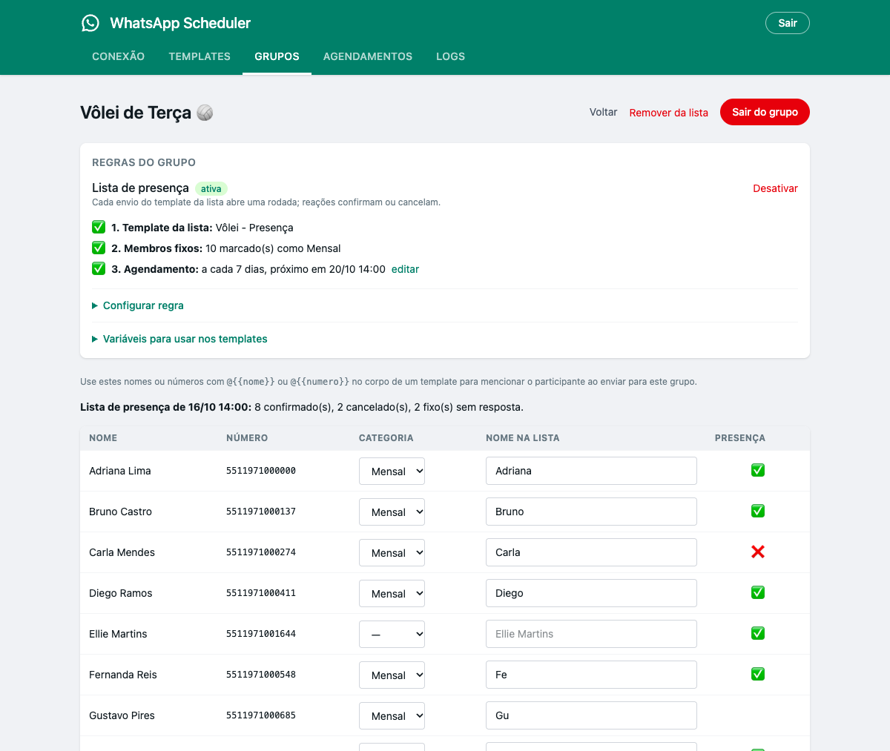
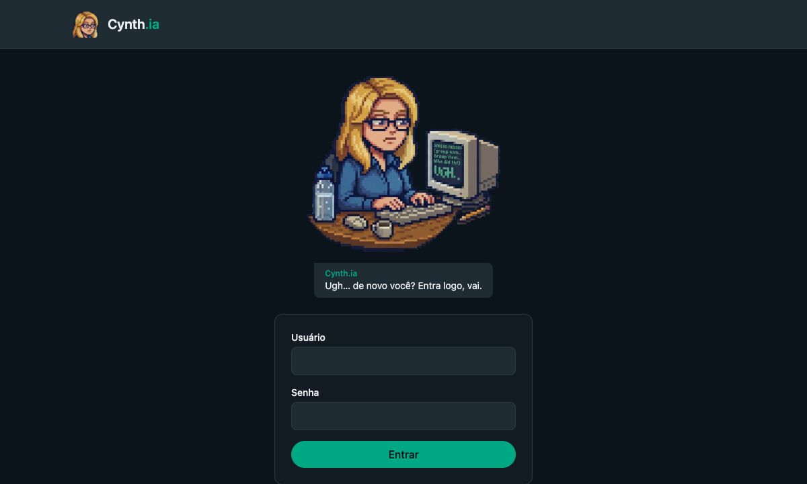
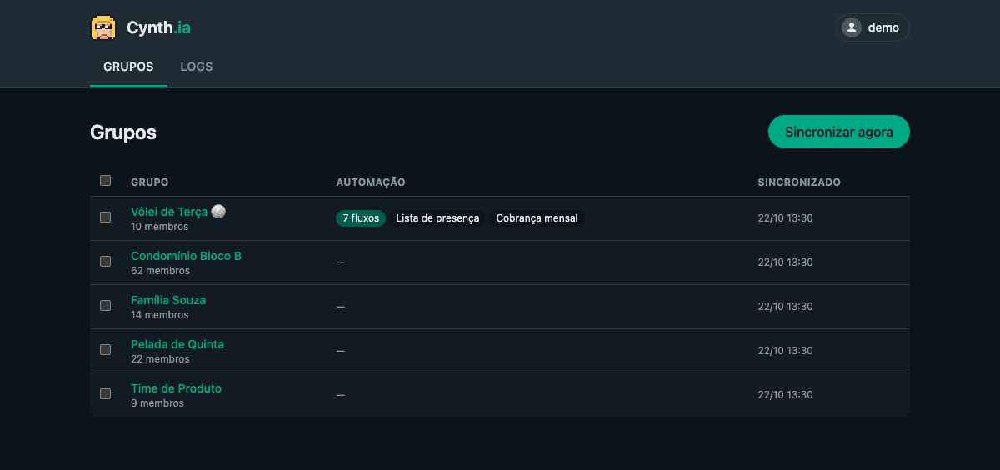
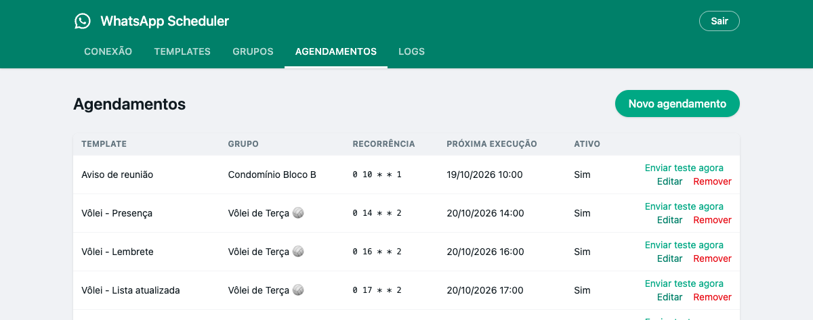
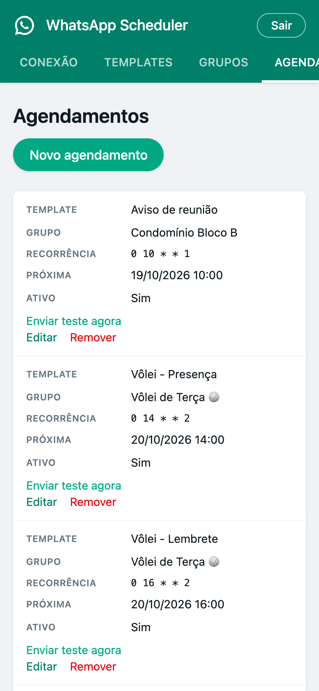
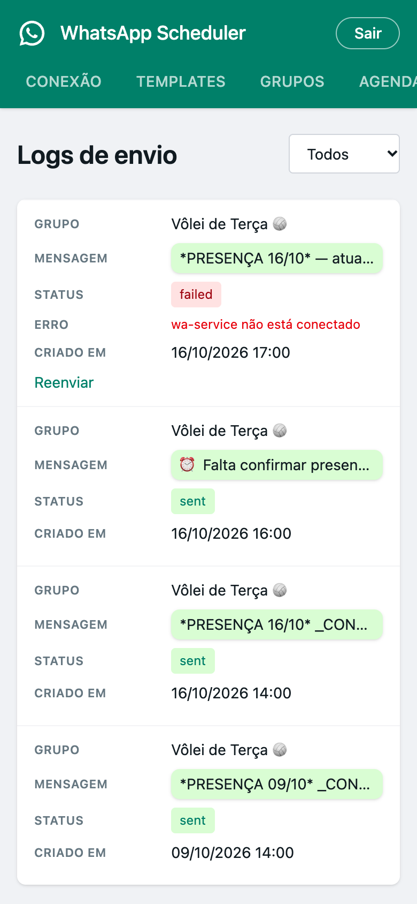
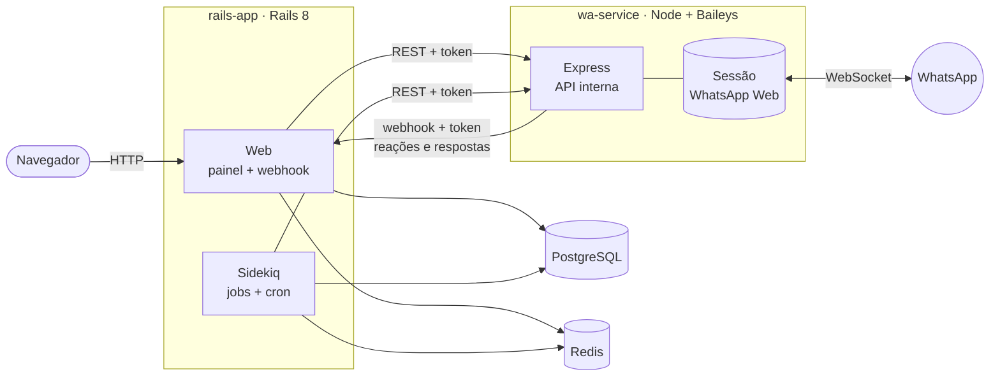
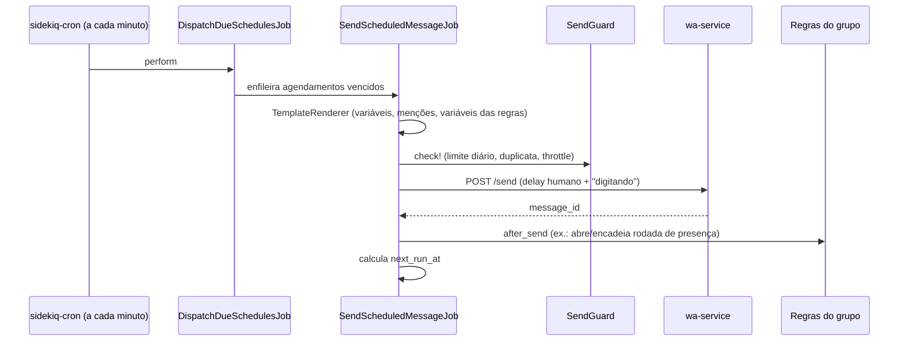
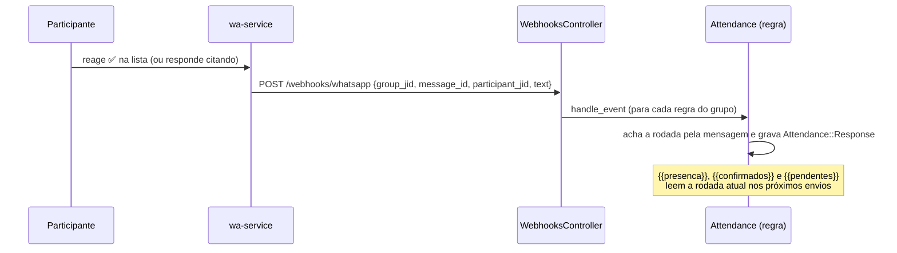
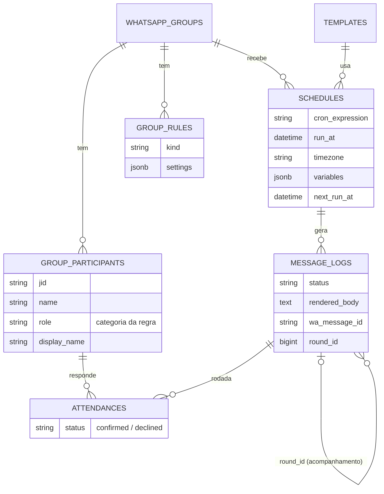

# WhatsApp Scheduler

Painel self-hosted para **agendar mensagens em grupos de WhatsApp**, com templates, variáveis
automáticas, menções e **regras por grupo**, como uma lista de presença que registra quem confirma
com ✅ ou cancela com ❌ reagindo à mensagem.

Nasceu para automatizar um grupo de vôlei: toda terça sai a lista de presença com os mensalistas
marcados, as reações viram confirmações, um lembrete marca quem ainda não respondeu e, no início do
mês, sai a cobrança.



> [!WARNING]
> O envio usa o [Baileys](https://github.com/WhiskeySockets/Baileys), uma biblioteca **não oficial**
> do WhatsApp Web. Isso viola os Termos de Serviço do WhatsApp e pode levar ao **bloqueio do número**.
> Use um número secundário. O sistema tem limites anti-spam (veja [Proteções de envio](#proteções-de-envio)),
> mas eles reduzem o risco, não o eliminam.

## Sumário

- [Funcionalidades](#funcionalidades)
- [Telas](#telas)
- [Arquitetura](#arquitetura)
- [Como rodar](#como-rodar)
- [Guia de uso](#guia-de-uso)
- [Criando uma nova regra de grupo](#criando-uma-nova-regra-de-grupo)
- [API interna do wa-service](#api-interna-do-wa-service)
- [Desenvolvimento](#desenvolvimento)
- [Limitações conhecidas](#limitações-conhecidas)

## Funcionalidades

**Núcleo (vale para qualquer grupo)**

- **Conexão** com o WhatsApp por QR Code. Se a sessão for revogada, um QR novo é gerado sozinho.
- **Grupos** sincronizados a cada 30 minutos, com participantes. Dá para sair de um grupo ou removê-lo
  do painel, um por vez ou vários de uma vez (a saída em lote roda em segundo plano, com intervalo
  entre cada grupo).
- **Templates** com variáveis (`{{nome}}`), variáveis automáticas de data, menções (`@{{Caio}}`) e
  menção a todos (`@{{todos}}`), e
  prévia ao vivo em balão de conversa com a formatação do WhatsApp (`*negrito*`, `_itálico_`, `~riscado~`).
- **Agendamentos** recorrentes (cron, com fuso horário) ou de envio único, com botão de envio de teste.
- **Logs** de cada envio, com status, erro e reenvio.
- **Login** por sessão e interface **responsiva** (no celular, tabelas viram cartões).

**Regras por grupo (opcionais)**

- **Lista de presença**: o template escolhido abre uma rodada a cada envio. Reações e respostas citando
  a mensagem viram confirmação ou cancelamento, e qualquer participante pede a lista atual mandando
  `!lista` no grupo. Tudo é configurável por grupo: categorias de membros, emojis, se respostas por
  texto contam, o formato das listas, o comando e o template da resposta.

## Telas

| Login | Conexão |
|---|---|
|  |  |

| Grupos (com seleção em lote) | Template com prévia |
|---|---|
|  |  |

| Agendamentos | Logs |
|---|---|
|  |  |

**Configuração da regra Lista de presença**


**No celular**

<p>
  
  
  
</p>

> Os prints usam dados fictícios.

## Arquitetura

São dois serviços de aplicação mais Postgres e Redis, orquestrados pelo Docker Compose:



| Serviço | Stack | Responsabilidade |
|---|---|---|
| `rails` | Rails 8.1, Hotwire (Turbo + Stimulus), Tailwind 4, importmap | Painel, regras de negócio, webhook |
| `sidekiq` | Sidekiq 8 + sidekiq-cron (mesma imagem do Rails) | Disparo dos agendamentos, envio, sincronização, saída de grupos em lote |
| `wa` | Node 20, TypeScript, Express 5, Baileys 6.7 | Mantém a sessão do WhatsApp; envia, lista grupos, sai de grupos e repassa eventos |
| `db` | PostgreSQL 16 | Dados |
| `redis` | Redis 7 | Filas do Sidekiq e throttle de envio |

**Por que dois serviços?** O Baileys só existe em Node e precisa de um processo vivo segurando o
WebSocket da sessão. O Rails não guarda esse estado: ele fala com o `wa-service` por uma API REST
interna, protegida por `INTERNAL_API_TOKEN`. O caminho inverso (reações e respostas recebidas) chega
ao Rails por um webhook protegido pelo mesmo token.

### Fluxo de envio



### Fluxo da lista de presença



### Núcleo × regras por grupo

O núcleo (grupos, templates, agendamentos, envio, webhook) **não sabe nada de presença**. Regras são
linhas em `group_rules` (`kind` + `settings` em JSON) e cada `kind` é implementado por um módulo. O
núcleo só chama esses ganchos:

| Gancho | Quando é chamado |
|---|---|
| `provides_variable?(rule, key)` | ao validar um agendamento: a variável é desta regra? |
| `render_variable(rule, key, mentions)` | ao renderizar um template para o grupo |
| `after_send(rule, message_log)` | depois de cada envio com sucesso ao grupo |
| `handle_event(rule, event)` | quando chega uma reação ou resposta no grupo |
| `settings_from(params)` | ao salvar o formulário da regra |

Hoje existe uma regra, a **Lista de presença** (`app/models/attendance.rb`). Veja
[Criando uma nova regra de grupo](#criando-uma-nova-regra-de-grupo).

### Modelo de dados



### Proteções de envio

O `SendGuard` bloqueia o envio antes de chegar ao WhatsApp:

| Proteção | Valor |
|---|---|
| Limite diário de envios | 50 |
| Intervalo mínimo entre envios | 20 s (lock no Redis) |
| Mensagem idêntica no mesmo grupo | bloqueada por 6 h |
| Antes de cada envio (`wa-service`) | "digitando…" por 2 s + espera aleatória de 3 a 12 s |
| Saída de grupos em lote | 3 a 8 s entre cada grupo |

### Jobs agendados

| Job | Frequência | O que faz |
|---|---|---|
| `DispatchDueSchedulesJob` | a cada minuto | Enfileira os agendamentos com `next_run_at` vencido |
| `SyncGroupsJob` | a cada 30 min | Atualiza grupos e participantes |
| `SendScheduledMessageJob` | sob demanda | Renderiza o agendamento, entrega e reagenda |
| `DeliverMessageJob` | sob demanda | Passa pelo `SendGuard`, envia e registra o log (agendamentos e respostas a comandos) |
| `LeaveGroupsJob` | sob demanda | Sai de vários grupos, um por vez |

## Como rodar

### Requisitos

- Docker e Docker Compose
- Um número de WhatsApp **secundário** para escanear o QR Code

### Passo a passo

```bash
git clone git@github.com:caiovitorsantos/whatsapp-scheduler.git
cd whatsapp-scheduler
cp .env.example .env
```

Preencha o `.env`:

| Variável | Para que serve |
|---|---|
| `INTERNAL_API_TOKEN` | Token entre Rails e wa-service. Gere com `ruby -rsecurerandom -e "puts SecureRandom.hex(32)"` |
| `RAILS_MASTER_KEY` | Conteúdo de `rails-app/config/master.key` |
| `ADMIN_USERNAME` / `ADMIN_PASSWORD` | Login do painel |
| `DATABASE_URL`, `REDIS_URL`, `WA_SERVICE_URL` | Já vêm prontos para o Docker Compose |

Suba tudo e prepare o banco:

```bash
docker compose up -d --build
docker compose exec rails bin/rails db:prepare
```

Abra **http://localhost:3000**, entre com o usuário e a senha do `.env` e, na aba **Conexão**,
escaneie o QR Code pelo celular (WhatsApp → Dispositivos conectados → Conectar dispositivo).

O `wa` e o `sidekiq` sobem com `restart: unless-stopped`: voltam sozinhos se caírem ou se o Docker
reiniciar.

## Guia de uso

### 1. Templates

Escreva o texto com a formatação do WhatsApp e use variáveis:

| Variável | Valor |
|---|---|
| `{{qualquer_nome}}` | Preenchida pelo JSON do agendamento (ex.: `{"dia": "25/10"}`) |
| `{{data}}` | Data do envio (`dd/mm`) |
| `{{mes}}`, `{{mes_num}}`, `{{mes_anterior}}` | `Outubro`, `10`, `Setembro` |
| `@{{Caio}}` ou `@{{5511999999999}}` | Menciona o participante (pelo nome exato ou pelo número) |
| `@{{todos}}` (ou `@{{all}}`) | Mostra "@todos" e notifica **todos** os participantes sincronizados, sem listar os números |

As datas usam o fuso do agendamento. Grupos com regras oferecem variáveis extras (abaixo).

### 2. Agendamentos

Escolha template e grupo e informe **ou** um cron **ou** uma data de envio único. O botão
"Pré-visualizar" mostra os próximos disparos.

| Cron | Quando |
|---|---|
| `0 14 * * 2` | Toda terça às 14h |
| `0 9 1 * *` | Dia 1 de cada mês às 9h |
| `0 9 * * 1-5` | Dias úteis às 9h |

Um agendamento que usa uma variável que o grupo não oferece é recusado ao salvar.

### 3. Regra "Lista de presença"

Na página do grupo, em **Regras do grupo**, clique em **Ativar**. O checklist da regra mostra o que
falta:

1. **Template da lista**: o template cujo envio abre uma nova rodada.
2. **Membros fixos**: marque a **Categoria** de cada participante na tabela do grupo.
3. **Agendamento**: o atalho cria o agendamento já com o template e o grupo preenchidos.

Em **Configurar regra**:

| Configuração | Padrão |
|---|---|
| Categorias (nome + se é **fixa**) | Mensal (fixa), Avulso, Espera |
| Emojis que confirmam / cancelam | `✅ ✔ ☑ 👍` / `❌ ✖ ❎ 👎` |
| Aceitar respostas citando a lista | sim |
| Estilo da lista | numerada (`1.`), `•`, `-` ou sem marcador |
| Marcas de confirmado / cancelado / sem resposta | `✅` / `❌` / nada |
| Texto de lista vazia | `1.` |
| Comando para pedir a lista | `!lista` (vazio desativa) |
| Template da resposta ao comando | padrão: presença + avulsos |

Categoria **fixa** quer dizer que a pessoa aparece em `{{presenca}}` e é cobrada em `{{pendentes}}`.
Quem confirma sem estar numa categoria fixa (um avulso, ou alguém que entrou depois da última
sincronização) aparece em `{{confirmados}}`.

**Variáveis da regra.** Todas aceitam uma categoria opcional, como em `{{lista:espera}}`:

| Variável | Sem categoria | Exemplo de saída |
|---|---|---|
| `{{lista}}` | nomes das categorias fixas | `1. Adriana`<br>`2. Bruno` |
| `{{mencoes}}` | fixos marcados (notifica) | `1. @Adriana`<br>`2. @Bruno` |
| `{{presenca}}` | fixos com a marca da resposta | `1. Adriana ✅`<br>`2. Bruno ❌`<br>`3. Carla` |
| `{{confirmados}}` | quem confirmou fora das fixas | `1. Ellie` |
| `{{pendentes}}` | marca os fixos que não responderam | `@Carla @Igor` |

Nas menções, a mensagem leva `@<número>` e o WhatsApp exibe o nome da pessoa marcada, como nos exemplos.

Reações em mensagens que mostram a rodada (por exemplo, um lembrete com `{{pendentes}}`, uma lista
atualizada com `{{presenca}}` ou a resposta ao `!lista`) também contam para a mesma rodada.

**Comando `!lista`.** Qualquer participante, inclusive o dono do número conectado, manda `!lista` no
grupo e o bot responde com a lista da rodada atual. A resposta passa pelos mesmos limites de envio:
se a lista não mudou, ela não é reenviada em 6 horas. Renomear uma categoria não quebra os
templates, porque a variável usa a chave mostrada ao lado do nome (`:mensal`).

### Exemplo completo: grupo de vôlei

| Template | Corpo | Cron |
|---|---|---|
| Presença (abre a rodada) | `*PRESENÇA {{data}}*`<br>`_Reaja com ✅ ou ❌_`<br><br>`{{mencoes}}`<br><br>`*Avulsos*`<br>`1.` | `0 14 * * 2` |
| Lembrete | `⏰ Falta confirmar: {{pendentes}}` | `0 16 * * 2` |
| Lista atualizada | `*PRESENÇA {{data}}*`<br>`{{presenca}}`<br><br>`*Avulsos*`<br>`{{confirmados}}` | `0 17 * * 2` |
| Cobrança | `*PAGAMENTO {{mes_anterior}}*`<br>`🚨 até 10/{{mes_num}}`<br><br>`{{mencoes}}` | `0 9 1 * *` |

## Criando uma nova regra de grupo

1. Crie um módulo em `app/models/<regra>.rb` que responda aos ganchos da tabela
   [Núcleo × regras por grupo](#núcleo--regras-por-grupo). Use `app/models/attendance.rb` como modelo.
2. Registre a regra em `GroupRule::HANDLERS` e `GroupRule::NAMES` (`app/models/group_rule.rb`).
3. Crie o bloco da regra em `app/views/group_rules/_<kind>.html.erb` e renderize-o na página do grupo
   (`app/views/groups/show.html.erb`).
4. Guarde as configurações em `rule.settings` (JSON). Tabelas próprias só se a regra precisar guardar
   dados, como `attendances` na Lista de presença.

## API interna do wa-service

Base: `WA_SERVICE_URL` (`http://wa:3001` no Compose). Todas as rotas, exceto `/health`, exigem o
header `Authorization: <INTERNAL_API_TOKEN>`.

| Método | Rota | Descrição |
|---|---|---|
| `GET` | `/health` | `{status, connected}`; status é `connected`, `qr_pending` ou `disconnected` |
| `GET` | `/qr` | QR Code atual (data URL) |
| `GET` | `/groups` | Grupos com participantes (`jid`, `name`) |
| `POST` | `/send` | `{group_jid, message, mentions?}` → `{status, message_id}` |
| `POST` | `/groups/leave` | `{group_jid}`: sai do grupo |
| `POST` | `/logout` | Encerra a sessão e gera um novo QR |

**Webhook (wa-service → Rails):** `POST RAILS_WEBHOOK_URL` (`/webhooks/whatsapp`) com
`{kind: "reaction" | "reply" | "command", group_jid, message_id, participant_jid, push_name, text}`.
Uma reação removida chega com `text` vazio. Mensagens que começam com `!` chegam como `command`.

## Desenvolvimento

```bash
# Testes e lint (RSpec + RuboCop)
docker compose run --rm -e RAILS_ENV=test rails bash -c "bin/rails db:prepare && bundle exec rspec && bin/rubocop"

# Checagem de tipos do wa-service
docker compose exec wa npx tsc --noEmit -p .

# Recompilar o CSS depois de usar classes novas do Tailwind (o container não roda o watch)
docker compose exec rails bin/rails tailwindcss:build

# Migrations
docker compose exec rails bin/rails db:migrate
```

O `wa-service` roda com `tsx watch`: mudanças em `wa-service/src` recarregam sozinhas.

### Estrutura

```
.
├── docker-compose.yml
├── rails-app/
│   ├── app/
│   │   ├── controllers/      # painel, login, webhook, regras de grupo
│   │   ├── jobs/             # despacho, envio, sincronização, saída em lote
│   │   ├── models/
│   │   │   ├── group_rule.rb       # registro de regras por grupo
│   │   │   └── attendance.rb       # regra "Lista de presença"
│   │   ├── services/         # TemplateRenderer, SendGuard, WaClient, ScheduleCalculator
│   │   └── views/
│   ├── config/schedule.yml   # cron do sidekiq-cron
│   └── spec/                 # RSpec
├── wa-service/src/
│   ├── server.ts             # API REST interna
│   └── whatsapp.ts           # sessão Baileys, QR, eventos → webhook
└── docs/screenshots/
```

## Limitações conhecidas

- **Risco de bloqueio** do número, inerente ao uso do Baileys.
- **Lista copiada e colada não é lida.** Só reações e respostas citando a mensagem viram confirmação.
- **Uma rodada aberta por grupo:** a mais recente do template da lista.
- **Lembrete sem pendentes sai mesmo assim**, com `{{pendentes}}` vazio.
- **Admin único**, com credenciais no `.env`.
